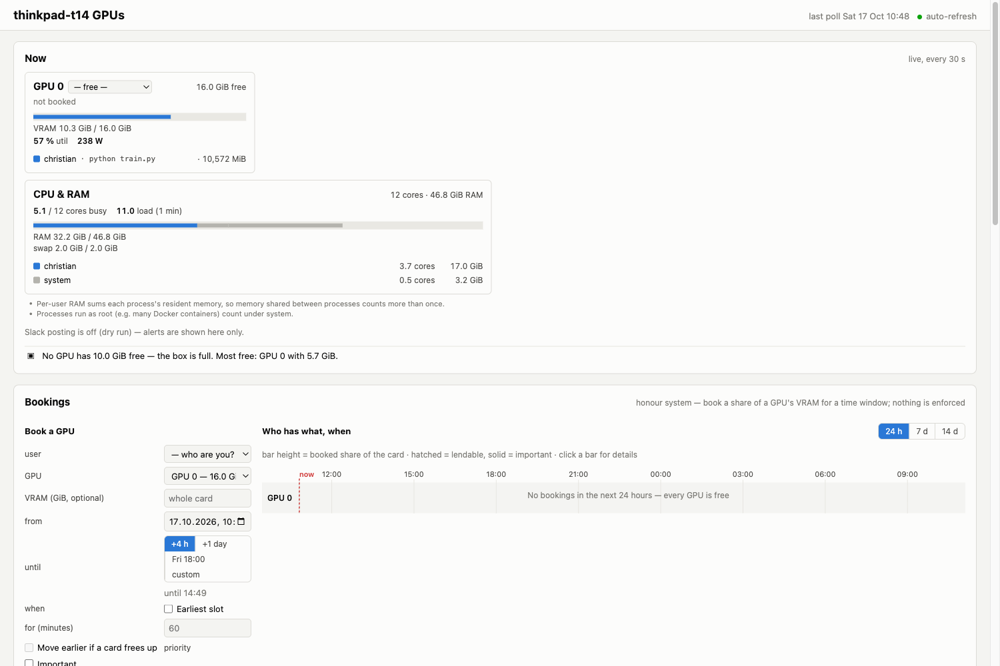
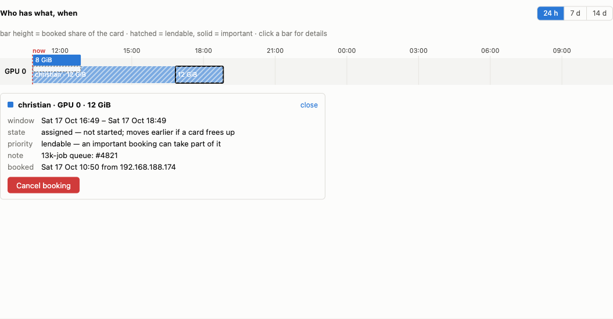
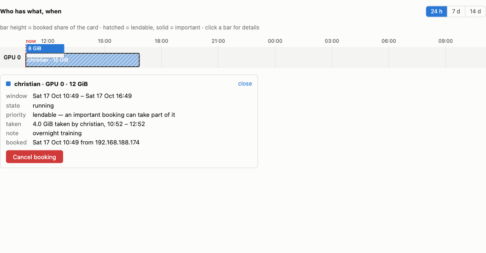

# Walkthrough: sharing one GPU between a long queue and someone who needs it now

This is the booking model end to end, run against a real box. Every transcript and
screenshot below is from an actual run on the ThinkPad t14 (one RTX 4080 SUPER, 16376 MiB)
on 17 October 2026 — nothing here is illustrative.

The problem it solves: one person has thousands of short jobs to get through, another needs
a card for the next hour. Without a queue the first person either hogs the box or babysits
a terminal, and the second refreshes a dashboard hoping for a gap.

Two scripts reproduce everything: [`examples/demo/01-queue.sh`](../examples/demo/01-queue.sh)
needs no GPU, [`examples/demo/02-preemption.sh`](../examples/demo/02-preemption.sh) needs a
free one.

```bash
cd examples/demo
HRM_URL=http://192.168.188.88:8765 HRM_USER=christian ./01-queue.sh
```

---

## 1. What is free, and when

`hrm.capacity()` is the one authoritative answer. Do not sum bookings yourself — the server
owns that arithmetic, and every client that reimplemented it got it wrong.

```python
cap = hrm.capacity(memory=19.5, hours=1)
cap.free_gib     # what is unbooked right now
cap.earliest     # when that shape would next fit, even if that is in three days
cap.gpu          # which card it would land on
```



That screenshot is worth reading closely, because it shows the honour system's one real
hole. The card has **10.3 GiB in use at 57 % utilisation**, and the bookings panel says
*"No bookings in the next 24 hours — every GPU is free"*. Someone started a training run
without booking it. The monitor sees the process and names the user; the booking server
does not know it exists.

So `capacity()` tells you what is **booked**, not what is **used**. Reserve a card and you
may still meet someone else's memory on it. That is a social problem with a technical
alarm, not a technical problem — the alerts fire, the dashboard names you, and that is the
whole enforcement there is.

## 2. A full box is not a refusal

`hrm.reserve()` does not fail because the box is busy. It answers with a window, and
`assigned_later` says whether that window starts now.

```
== Book the whole card for two hours
   booking 45 on GPU 0, 10:38:19 -> 12:38:19, assigned_later=False

== Book the same card again -- the box is now full
   No NoCapacity, no retry loop: the server answers with a window in the future.
   booking 46 on GPU 0, 12:38:19 -> 13:38:19, assigned_later=True
   it waits for the first one to end. A job would now call wait_until_start().
```

The second booking is a real calendar row, not a queue entry in some side table. That is
what makes the rest work: capacity checks, the dashboard and the energy report all treat it
like any other booking, with no new concepts to teach them.



## 3. Giving a card back moves the queue up

Releasing early is the part people skip, so it has to be worth doing. `release()` moves the
booking's **end** to now rather than deleting it — the window you really used stays on the
calendar and in the energy report — and whoever is waiting for that card moves up in the
same transaction:

```
== Release the first booking early
   booking 45 now ends 10:38:19 (cancelled: False)
   -> booking 46 moved from 12:38:19 to 10:38:19
```

Nothing scans for this on a timer. A slot can only become available because someone gave
capacity back, and that is a write — so the advance happens inside that write and nowhere
else.

## 4. Lendable and important

A booking is `lendable` unless you ask for `important`. Important bookings get their full
VRAM; what is left of the card goes to lendable ones, oldest first, so the **newest**
lendable booking is the first to shrink.



The hatched bar is lendable, the solid one important. The detail pane spells out what was
taken, by whom and when. Nothing about that is stored: cancel the important booking and the
capacity comes back by itself.

## 5. Being preempted, end to end

A batch job books `lendable` with `notice_seconds=0` — *"take this card whenever you need
it"* — and parks a long-poll so the server can tell it in milliseconds. Here is a real run
being interrupted at epoch 31:

```
epoch 29  loss 1.0030  4.1s  5.3 GiB on GPU 0
epoch 30  loss 1.0025  3.9s  5.3 GiB on GPU 0
epoch 31  loss 1.0026  3.9s  5.3 GiB on GPU 0
preempted: GPU 0 was taken by christian
checkpoint is at /home/christian/runs/hrm-preempt/checkpoint.pt; run the same command to carry on
```

and the same thing from the other side, from `02-preemption.sh`:

```
== Now someone needs the card: an important booking for most of it
   booking 50 placed in 0.04s, starts 10:47:00
   revoked booking 47 of christian: 5128 MiB lost, truncated=True
   revoked booking 49 of christian: 6144 MiB lost, truncated=True

== What the job did about it
   It stops at the next epoch boundary -- the one place a checkpoint is safe.
   exit status: 0 (0 -- being preempted is not a failure)

== The victim's row: truncated, not deleted
   booking 49  10:43:47 -> 10:44:04  cancelled=False  priority=lendable

== It can carry on where it stopped
   checkpoint at epoch 3 (10 layers) -- the same command resumes from 4
```

(That run revoked two bookings because an earlier, broken run of the demo had left one
behind. The script now tags and releases its own, so a clean run revokes one.)

Three things in that transcript are the whole design:

- **`exit status: 0`.** Being preempted is a normal outcome. A job that checkpoints resumes;
  it did not fail.
- **`cancelled=False`.** The victim's row was truncated, not deleted. The eleven minutes it
  really ran stay on the calendar and in the energy report, so being tidy is not punished.
- **`0.04s`.** The important booking was placed and the victim told before anyone could
  refresh a page.

## 6. What the job's code looks like

There are two shapes, and the difference is how long the card stays held after the server
says someone else needs it.

**Ask at a safe point.** The simplest version checks between units of work:

```python
import hrm

with hrm.reserve(memory=19.5, hours=1, notice_seconds=5) as slot:
    for epoch in range(epochs):
        slot.check()            # raises hrm.Preempted once the card is taken
        train_one_epoch()
        save_checkpoint()
```

The watcher thread sets a flag and `check()` raises at the next boundary. That is honest
and simple, and it is right when an epoch is seconds long. It is wrong when an epoch is an
hour: the notice says "at once" and the card is held for another fifty minutes.

**Stop the work itself.** The other shape runs the job in a child process, so the parent
can end it the moment it is told:

```python
def train(stop, cfg):
    for epoch in range(cfg["epochs"]):
        for step in range(cfg["steps"]):
            if stop.is_set():           # checked every step, not every epoch
                save_checkpoint()       # the stop event is your last chance
                return
            one_step()
        save_checkpoint()

with hrm.reserve(memory=19.5, hours=1, notice_seconds=30) as slot:
    outcome = slot.run(train, args=(cfg,), grace=30)   # "completed" or "taken"
```

`Slot.run` sets `stop`, gives the child `grace` seconds to write its checkpoint, and ends it
if it will not go. The parent only ever stops **its own child** — nothing else is signalled,
here or anywhere else in this SDK. It is the shape
[`playground/revocation_mvp.py`](https://github.com/cwinkelmann/hnee-resource-monitoring)
prototyped against a watch file, with the long-poll in place of the file.

[`examples/train_gpu.py`](../examples/train_gpu.py) uses it, and resumes from its last
checkpoint when you run it again.

Two details that matter more than they look:

- **The child is started with `spawn`, not `fork`.** A process that has already initialised
  CUDA cannot be forked and still use the GPU, and the parent usually has. So the target
  must be a module-level function and its arguments must pickle.
- **Promise the notice you can keep.** If your checkpoint takes thirty seconds, book
  `notice_seconds=30`, not 0. The number is what the next person waits for, and a promise
  of 0 followed by thirty seconds of writing is worse than saying thirty.

Either way, nothing signals your process from outside. The server writes a row and tells a
client; your own code decides to stop. With no root on these boxes that is not one option
among several — it is the ceiling.

## 7. What this does not do

- **It enforces nothing.** See the screenshot in §1: a process can use a card nobody booked,
  and a job can ignore its revocation. The alerts name you; that is the mechanism.
- **The notice is only as good as what the job does with it.** With `slot.check()` it means
  "at the next boundary"; with `slot.run()` it means "within `grace`, including the
  checkpoint". Book the number you can actually keep.
- **A declared notice only counts while you are listening.** The server reads it from the
  parked long-poll, so a crashed job gets the box's full `grace_minutes` instead. It can
  never buy you *more* notice than that grace either.
- **`reserve()` can still refuse**, just not for being busy: `max_pending_per_user` (16 by
  default), a `not_later_than` the earliest slot misses, or nothing fitting in the 14-day
  horizon. The reason is on `err.extra`.

## Running the demos

| script | needs | shows |
|---|---|---|
| [`01-queue.sh`](../examples/demo/01-queue.sh) | a booking server | capacity, a queued slot, an early release pulling it forward |
| [`02-preemption.sh`](../examples/demo/02-preemption.sh) | a free GPU and PyTorch | a real training run being preempted, checkpointing and resuming |

```bash
export HRM_URL=http://192.168.188.88:8765
export HRM_USER=christian
cd examples/demo && ./01-queue.sh && ./02-preemption.sh
```

Both release every booking they make on the way out, including on Ctrl-C.
`02-preemption.sh` refuses to start if someone else's process is already on the card — a
booking is bookkeeping, so the server will happily hand you a card that is physically full,
and the demo would otherwise die of CUDA OOM and look like a bug:

```
   someone is already using the card:
      GPU 0: christian python train.py, 10572 MiB
   this demo needs a free card -- it would run out of CUDA memory.
```
